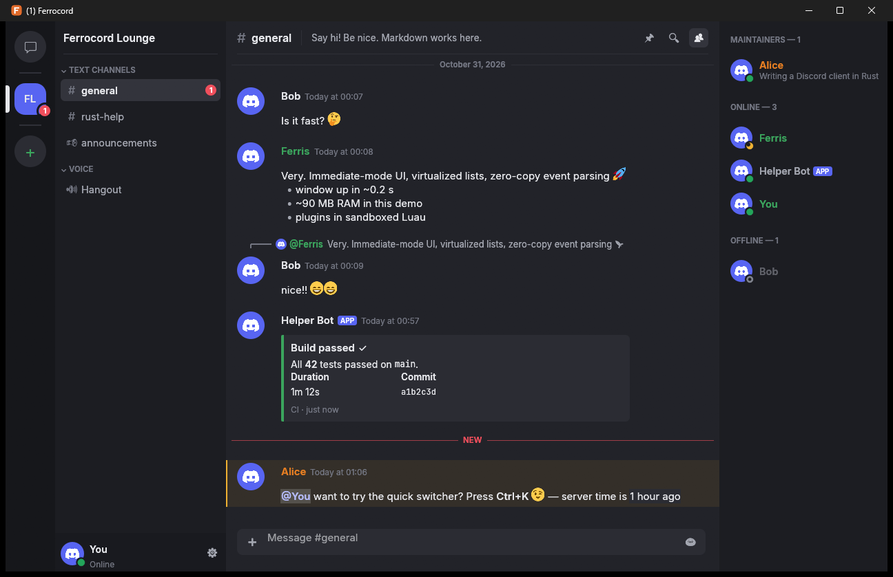
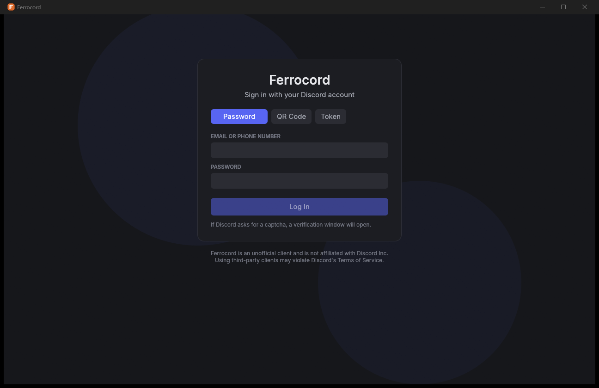
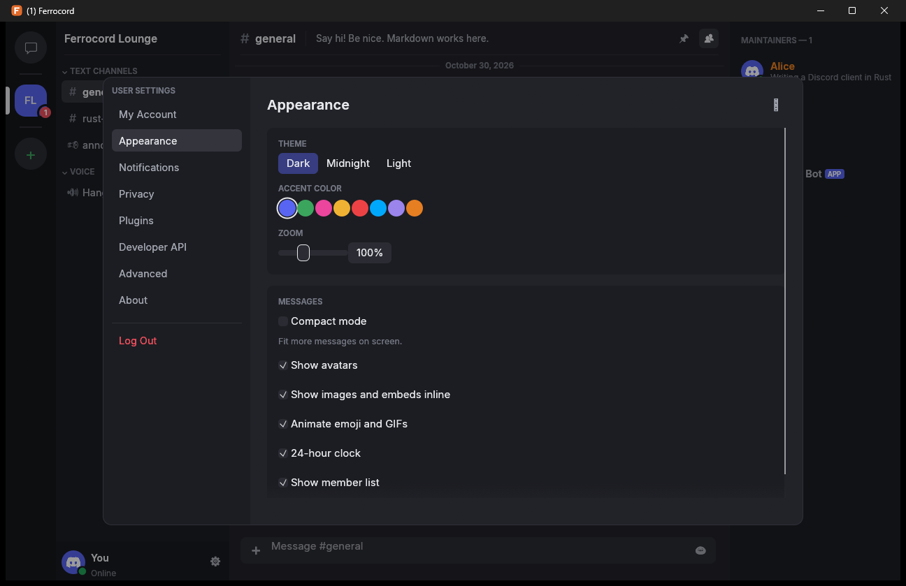

# Ferrocord

[](https://github.com/LB45440078L/Ferrocord/actions/workflows/ci.yml)
[](https://github.com/LB45440078L/Ferrocord/actions/workflows/release.yml)
[](https://github.com/LB45440078L/Ferrocord/releases/latest)
[](https://github.com/LB45440078L/Ferrocord/releases)
[](LICENSE)
[](https://www.rust-lang.org)
[](#installing)
[](https://github.com/emilk/egui)

**A fast, lightweight, open-source Discord client written in Rust.**

Ferrocord talks to Discord's servers using the same protocol as the official
desktop app: the v9 REST API, the zlib-compressed gateway, and the
QR-code "remote auth" handshake. Instead of a 400 MB Electron bundle, it is a
single native binary with an immediate-mode GPU UI. It also has a sandboxed
plugin system and a local API for your own tools.



> **Disclaimer.** Ferrocord is an unofficial third-party client. It is not
> affiliated with, endorsed or sponsored by Discord Inc. Discord's Terms of
> Service do not permit third-party clients, so using one carries a risk of
> account action. Use it at your own risk.

## Highlights

- **Native and small.** Rust + [egui](https://github.com/emilk/egui), with no
  browser engine in the main process. The message list and member list are
  virtualized, events are parsed without copying, and images are decoded off
  the UI thread and cached on disk.
- **Full login support.** Email/phone + password, two-factor (authenticator
  app, SMS, backup codes), QR-code login with the mobile app, and token login.
  When Discord asks for an hCaptcha, a small verification window opens.
- **Secure by default.** Tokens live in the OS credential vault (Windows
  Credential Manager, macOS Keychain, Secret Service). Ferrocord sends no
  telemetry of its own.
- **The chat features you use every day.**
  - Servers, folders, categories, threads, forums and DMs, with unread and
    mention badges.
  - Markdown: headers, lists, quotes, code blocks, spoilers, timestamps,
    mentions and custom or animated emoji.
  - Replies, edits, deletes, reactions, pins, attachments (upload by picker or
    drag-and-drop), embeds, stickers and system messages.
  - Typing indicators, lazy member lists with presence, profiles, a friends
    page, search, a quick switcher (`Ctrl+K`), custom status and desktop
    notifications.
- **Extensible.**
  - **Plugins**: Luau scripts with a permission model, CPU and memory limits,
    and storage. See [docs/PLUGINS.md](docs/PLUGINS.md).
  - **Local API**: HTTP + WebSocket on `127.0.0.1` with token auth, live events
    and JSON-RPC actions. See [docs/API.md](docs/API.md).
  - **Rust API**: embed `ferrocord-core` in your own program, or implement the
    `Extension` trait.

| Login | Settings |
|---|---|
|  |  |

## Installing

Download the file for your system from the
[latest release](https://github.com/LB45440078L/Ferrocord/releases/latest):

| System | Download |
|---|---|
| Windows 10/11 (x64 or ARM64) | `…-windows-<arch>.msi` (installs for you, or for all users via *Advanced*) or the portable `.zip` |
| Debian, Ubuntu (amd64 or arm64) | `ferrocord_<version>-1_<arch>.deb`: `sudo apt install ./ferrocord_*.deb` |
| Fedora, openSUSE (x86_64 or aarch64) | `ferrocord-<version>-1.<arch>.rpm`: `sudo dnf install ./ferrocord-*.rpm` |
| Any Linux | `.AppImage` (`chmod +x` and run) or the `.tar.gz` |
| macOS 12+ | `…-macos-arm64.dmg` (Apple Silicon) or `…-macos-x86_64.dmg` (Intel) |

Until release builds are code-signed, Windows SmartScreen may ask you to confirm,
and on macOS you approve the first launch in *System Settings > Privacy &
Security*. Every release lists SHA-256 checksums and build provenance
attestations. See [docs/USAGE.md](docs/USAGE.md#installing) for details.

To build the packages yourself, run `scripts\build-windows.cmd` on Windows,
`scripts/build-linux.sh` on Debian/Ubuntu or `scripts/build-macos.sh` on a Mac
(see [docs/RELEASING.md](docs/RELEASING.md#building-packages-locally)).

## Quick start

```sh
git clone https://github.com/LB45440078L/Ferrocord
cd ferrocord
cargo run --release            # log in with your account
cargo run --release -- --demo  # explore the UI offline with sample data
```

Requirements: Rust 1.95+ (edition 2024) and a C/C++ toolchain (MSVC on
Windows, clang/gcc elsewhere). Captchas on Windows need the WebView2 runtime,
which ships with Windows 10/11. Linux also needs the webkit2gtk, libdbus and
libxkbcommon development packages. See [docs/USAGE.md](docs/USAGE.md) for
details, keyboard shortcuts and configuration.

## Project status

Ferrocord is young. The text-chat experience is solid, but it does **not** yet
match the official client feature for feature. Being explicit about what's
missing:

| Area | Status |
|---|---|
| Login: password, TOTP/SMS/backup 2FA, QR, token, captcha | ✅ |
| Gateway: identify, resume, reconnect, zlib-stream, lazy guilds (op 37) | ✅ |
| Text chat: send, edit, delete, reply, react, pin, attachments, markdown, embeds | ✅ |
| Read states, mentions, notifications, mute settings | ✅ |
| Friends, DMs, group DMs, profiles, status and custom status | ✅ |
| Threads and forum posts (read and reply) | ✅ |
| Search, pins, quick switcher, invites (join) | ✅ |
| Plugins and local API | ✅ |
| Security-key (WebAuthn) 2FA | ❌ use QR login instead |
| Voice and camera video in servers and DMs, DAVE end-to-end encryption | ✅ (not yet tested against live Discord) |
| Screen share / Go Live, soundboard, noise suppression | ❌ planned |
| Slash commands / app interactions, polls, soundboard, activities | ❌ planned |
| Server administration UI (roles, channel editing, moderation panels) | ⚠️ partial (kick, ban and timeout exist as REST helpers in `ferrocord-http`, with no UI yet) |
| Account settings editing (avatar, password, 2FA setup), Nitro and billing | ❌ use the official app |

See [docs/ARCHITECTURE.md](docs/ARCHITECTURE.md) for how the pieces fit
together, and [docs/PROTOCOL.md](docs/PROTOCOL.md) for the reverse-engineered
protocol notes these features are built on.

## Workspace layout

| Crate | Purpose |
|---|---|
| `crates/model` | Serde wire types: users, guilds, channels, messages, gateway events, the settings protobuf |
| `crates/http` | REST client: client fingerprint, rate limits, captcha and MFA interceptors, typed routes |
| `crates/gateway` | Websocket connection: zlib-stream, heartbeats, resume, backoff |
| `crates/auth` | Password/MFA login, QR remote auth, credential-vault token storage |
| `crates/store` | Normalized in-memory state cache, built from events |
| `crates/core` | `Client` orchestrator, actions, events, config, the `Extension` trait |
| `crates/plugin` | Sandboxed Luau plugin runtime |
| `crates/api` | Local HTTP + WebSocket control API |
| `crates/voice` | Voice gateway v9, UDP/RTP transport encryption, DAVE E2EE, Opus audio engine, video pipeline |
| `crates/media` | Camera capture, H.264 encode/decode, RTP H.264 packetization |
| `crates/testkit` | Mock Discord (REST, gateway, remote auth) for integration tests |
| `crates/app` | The desktop application (`ferrocord` binary) |

## Contributing

Contributions are welcome! Please read [CONTRIBUTING.md](CONTRIBUTING.md).
Security issues: see [SECURITY.md](SECURITY.md).

## License

Ferrocord is licensed under the [BSD 3-Clause License](LICENSE).

Bundled fonts: [Inter](https://rsms.me/inter/) and
[JetBrains Mono](https://www.jetbrains.com/lp/mono/) under the SIL Open Font
License (see `crates/app/assets/fonts`). Emoji images are
[Twemoji](https://github.com/jdecked/twemoji) (CC-BY 4.0), loaded at runtime.
"Discord" is a trademark of Discord Inc.
